# Hướng Dẫn Giám Sát Card Mạng Proxmox Cluster Bằng InfluxDB Và Grafana

Thu thập đầy đủ thông số như `ip -s link` và `ethtool -S`, trạng thái UP/DOWN và tốc độ link card 10G/25G trên **mọi node** của cluster Proxmox VE. Dữ liệu đi thẳng vào InfluxDB qua tiến trình `pvestatd` có sẵn của Proxmox và hiển thị trên Grafana. **Không cần cài agent.**

**Mục lục:**
[Giới thiệu](#1-giới-thiệu) ·
[Kiến trúc](#2-kiến-trúc) ·
[Thông số thu thập](#3-thông-số-thu-thập) ·
[Yêu cầu](#4-yêu-cầu) ·
[Cài đặt nhanh](#6-cài-đặt-nhanh) ·
[Lệnh của script](#7-các-lệnh-của-script) ·
[Dashboard](#8-dashboard-grafana) ·
[Cảnh báo](#9-cảnh-báo) ·
[Vận hành](#10-vận-hành) ·
[Tài liệu chi tiết](#11-tài-liệu-chi-tiết)

---

## 1. Giới thiệu

Metric mặc định mà Proxmox gửi sang InfluxDB chỉ có **băng thông TX/RX**. Khi cluster gặp sự cố mạng như cáp lỗi, SFP bẩn, link chập chờn hay card 25G chạy tụt xuống 10G, dashboard thường **không thấy gì bất thường**.

Bộ công cụ này bổ sung các chỉ số mạng ở mức thấp vào ngay luồng metric gốc của Proxmox:

| Vấn đề thường gặp | Thấy được qua |
|---|---|
| Cáp/DAC hỏng, SFP bẩn | `rx_crc_errors`, `port.rx_crc_errors` tăng theo thời gian |
| Link chập chờn (flapping) | Panel NIC Link Status và NIC Link Speed theo thời gian |
| Card 25G chỉ chạy 10G | So sánh `link_speed` với `link_speed_max` |
| Ring buffer đầy, CPU xử lý không kịp | `rx_missed_errors`, `rx_fifo_errors` |
| Corosync mất ổn định | `udp_loss`, `corosync_conn` |

**Điểm mạnh:**

- **Chạy native:** nằm trong `pvestatd` của Proxmox, không cài Telegraf, node_exporter hay vòng lặp bash.
- **Triển khai hàng loạt:** một lệnh cài cho cả cluster qua SSH.
- **An toàn:** kiểm tra `perl -c` trước khi ghi, có backup `.bak`, chạy lại không bị chèn trùng, gỡ sạch được.
- **Tự chẩn đoán:** lệnh `diag` chỉ ra lỗi nằm ở module, cấu hình, kết nối hay InfluxDB.
- **Dashboard sẵn:** tự sinh đúng bucket và datasource cho từng cluster.

---

## 2. Kiến trúc

### 2.1. Tổng quan hệ thống

Admin chạy script trên một node để cài module lên toàn cluster qua SSH. Sau đó mỗi node tự gửi số liệu sang InfluxDB 10 giây/lần, Grafana đọc bằng Flux để vẽ dashboard và gửi cảnh báo.

<p align="center"></p>

### 2.2. Luồng thu thập trên mỗi node

Mỗi chu kỳ, `pvestatd` gọi `update_node_status()` trong plugin InfluxDB của Proxmox. Đoạn patch gọi thêm module `CustomNetworkMetrics`, module đọc 4 nguồn số liệu rồi gắn vào measurement `nics` (theo từng card) và `system` (theo node).

<p align="center"></p>

Script chỉ **chèn một đoạn nhỏ** vào hàm `update_node_status` trong `/usr/share/perl5/PVE/Status/InfluxDB.pm`, không ghi đè cả file, nên dùng được với nhiều phiên bản Proxmox. Module bắt mọi lỗi bên trong: nếu đọc số liệu lỗi thì `pvestatd` vẫn chạy bình thường.

### 2.3. Lệnh `install` làm gì trên mỗi node

<p align="center"></p>

---

## 3. Thông số thu thập

### 3.1. Card mạng: measurement `nics`

Tag: `host` (tên node), `instance` (tên card, ví dụ `enp24s0f2np2`).

**Bộ đếm kernel (giống `ip -s link`)**

| `ip -s link` | Field |
|---|---|
| RX bytes / packets | `rx_bytes`, `rx_packets` |
| RX errors / dropped / missed / mcast | `rx_errors`, `rx_dropped`, `rx_missed_errors`, `multicast` |
| TX bytes / packets | `tx_bytes`, `tx_packets` |
| TX errors / dropped / carrier / collsns | `tx_errors`, `tx_dropped`, `tx_carrier_errors`, `collisions` |
| Chi tiết lỗi | `rx_crc_errors`, `rx_length_errors`, `rx_over_errors`, `rx_fifo_errors`, `rx_frame_errors`, `rx_nohandler`, `tx_aborted_errors`, `tx_fifo_errors`, `tx_heartbeat_errors`, `tx_window_errors` |

**Counter driver (`ethtool -S`, chỉ card vật lý)**: mỗi tên có thêm tiền tố `ethtool_`, ký tự đặc biệt đổi thành `_`.

| `ethtool -S` | Field |
|---|---|
| `rx_crc_errors` | `ethtool_rx_crc_errors` |
| `veb.rx_discards` | `ethtool_veb_rx_discards` |
| `port.rx_crc_errors` | `ethtool_port_rx_crc_errors` |
| `port.tx_dropped_link_down` | `ethtool_port_tx_dropped_link_down` |

- Chỉ lấy counter có tên chứa *err, drop, discard, crc, miss, timeout, length, fifo, over, collision, carrier…*
- Bỏ counter theo từng queue (`rx_queue_0_*`, `tx-0.*`) để InfluxDB không bị phình.

**Trạng thái và tốc độ link**

| Field | Ý nghĩa |
|---|---|
| `network_up` | `1` = UP, `0` = DOWN |
| `link_speed` | Tốc độ hiện tại (Mb/s), `0` khi DOWN |
| `link_speed_max` | Tốc độ tối đa card hỗ trợ (Mb/s). Card 10G luôn là `10000`, kể cả khi DOWN |
| `hardware_drop` | Số gói rớt (RX dropped) |

Card ảo (`tap*`, `veth*`, `fwbr*`, `fwpr*`, `fwln*`) chỉ lấy trạng thái UP/DOWN, không lấy bộ đếm lỗi.

### 3.2. Hệ thống: measurement `system`

| Field | Ý nghĩa |
|---|---|
| `udp_loss` | Số gói UDP lỗi/rớt (`InErrors` trong `/proc/net/snmp`) |
| `udp_total` | Tổng gói UDP đã nhận (`InDatagrams`) |
| `corosync_conn` | Số kết nối Corosync đang hoạt động (cổng 5404/5405) |

---

## 4. Yêu cầu

| Thành phần | Yêu cầu |
|---|---|
| Proxmox VE | Đã cấu hình **Datacenter → Metric Server** loại **InfluxDB**, đang bật |
| InfluxDB | 2.x, có bucket, org và token ghi dữ liệu |
| Grafana | Datasource InfluxDB, ngôn ngữ truy vấn **Flux**, trỏ tới bucket trên |
| Trên node | Quyền `root`, có `ethtool` |
| SSH | Từ node chạy script tới các node: SSH key, hoặc mật khẩu + `sshpass` |

---

## 5. Cấu trúc repo

```
monitor-grafana-proxmox-cluster-influxdb/
├── README.md                                     Tổng quan (file này)
├── deploy/                                       Bộ cài: copy nguyên thư mục này lên node
│   ├── CustomNetworkMetrics.pm                   Module Perl thu thập số liệu
│   ├── deploy-monitor-nic-proxmox.sh             install / check / diag / dashboard / uninstall
│   ├── nodes.txt                                 Danh sách IP node (điền IP của bạn)
│   └── dashboard-template.json                   Dashboard Grafana mẫu
└── docs/
    ├── 01-Huong-Dan-Trien-Khai-Monitor-NIC-Proxmox.md   Hướng dẫn từng bước, bắt đầu ở đây
    ├── 02-Canh-Bao-Va-Xu-Ly-Su-Co-Card-Mang.md          Alert Grafana, đọc lỗi, xử lý sự cố, vận hành
    ├── 03-Cai-Dat-Thu-Cong-Patch-InfluxDB.md            Patch thủ công, giải thích nguyên lý
    └── images/                                          Sơ đồ SVG
```

> Cả 4 file trong `deploy/` phải nằm **cùng một thư mục** trên node, vì script tìm các file còn lại ngay cạnh nó.

---

## 6. Cài đặt nhanh

### 6.1. Quy trình

<p align="center"></p>

### 6.2. Các lệnh

Chạy trên node đầu tiên của cluster bằng `root`:

```bash
# Bước 2: lấy bộ cài
apt install -y git ethtool
git clone https://github.com/fixnhanh-linux/monitor-grafana-proxmox-cluster-influxdb.git /root/nic-monitor
cd /root/nic-monitor/deploy
chmod +x deploy-monitor-nic-proxmox.sh

# Bước 3: khai báo IP các node, mỗi dòng 1 IP
pvecm status | sed -n '/Membership information/,$p'
nano nodes.txt

# Bước 4: cài thử 1 node, output phải toàn [OK]
./deploy-monitor-nic-proxmox.sh install 10.0.0.11

# Bước 5: tạo dashboard đúng bucket của cluster (đọc từ /etc/pve/status.cfg)
./deploy-monitor-nic-proxmox.sh dashboard

# Bước 6-7: cài cho cả cluster rồi kiểm tra
./deploy-monitor-nic-proxmox.sh install -f nodes.txt
./deploy-monitor-nic-proxmox.sh check   -f nodes.txt
```

Kết quả mẫu khi cài thành công:

```
==> 10.0.0.11 (install)
[pve1]
  [OK] Da cai /usr/share/perl5/PVE/CustomNetworkMetrics.pm
  [OK] Da patch InfluxDB.pm (backup: /usr/share/perl5/PVE/Status/InfluxDB.pm.bak)
  [OK] Co ethtool
  [OK] pvestatd dang chay
  udp_loss=0 corosync_conn=4
  enp24s0f2np2     UP    10000/10000  rx_errors=67 rx_dropped=685 tx_dropped=878 rx_crc=67 (+17 counter ethtool)
Hoan thanh: 1 node OK
```

> **Node không có Internet?** Tải `monitor-nic-proxmox.zip` ở mục **Releases**, `scp` lên node rồi giải nén. Xem [hướng dẫn triển khai, bước 2](docs/01-Huong-Dan-Trien-Khai-Monitor-NIC-Proxmox.md#bước-2-lấy-bộ-cài-lên-pve1).

### 6.3. Import dashboard

Lệnh `dashboard` tạo file `dashboard-<bucket>.json`. Có hai cách đưa vào Grafana:

```bash
# Cách 1: script import luôn (token: Administration → Service accounts → role Editor)
export GRAFANA_URL=https://<IP-Grafana>:3000
export GRAFANA_TOKEN='glsa_xxx'
export GRAFANA_DS='ten-datasource-influxdb'   # tùy chọn
./deploy-monitor-nic-proxmox.sh dashboard

# Cách 2: import tay - copy file về máy rồi Dashboards → New → Import → Upload
```

---

## 7. Các lệnh của script

| Lệnh | Tác dụng |
|---|---|
| `install [-f nodes.txt \| ip...]` | Cài module, patch `InfluxDB.pm` (có backup), restart `pvestatd`, tự kiểm tra |
| `check [-f nodes.txt \| ip...]` | Kiểm tra module, patch, ethtool, pvestatd và in số liệu từng card |
| `diag [-f nodes.txt \| ip...]` | Chẩn đoán vì sao Grafana không có số liệu |
| `dashboard [bucket]` | Tạo `dashboard-<bucket>.json`; có `GRAFANA_URL` + `GRAFANA_TOKEN` thì import luôn |
| `uninstall [-f nodes.txt \| ip...]` | Khôi phục `InfluxDB.pm` gốc, xóa module, restart `pvestatd` |

Không truyền node thì script dùng `nodes.txt` nằm cạnh script.

| Biến môi trường | Mặc định | Ý nghĩa |
|---|---|---|
| `SSH_USER` | `root` | User SSH tới các node |
| `SSH_PASS` | (trống) | Mật khẩu SSH, cần cài `sshpass` |
| `GRAFANA_URL` | (trống) | URL Grafana để import dashboard |
| `GRAFANA_TOKEN` | (trống) | Token service account Grafana |
| `GRAFANA_DS` | (trống) | Tên datasource InfluxDB gắn vào dashboard |

### Lệnh `diag` kiểm tra lần lượt

<p align="center"></p>

Dòng **Ket luan** cuối cùng của lệnh cho biết lỗi nằm ở bước nào và cách xử lý.

---

## 8. Dashboard Grafana

Dashboard giữ các panel tổng quan của Proxmox (CPU, RAM, storage, VM) và thêm nhóm panel NIC. Các panel NIC **chỉ hiện card vật lý**, không hiện `vmbr*`, `bond*`, `br-*`, `docker0`.

| Panel | Kiểu | Nội dung |
|---|---|---|
| NIC Link Status (10G+) | State timeline | Mỗi card vật lý 10G+ một thanh, tên kèm tốc độ tối đa (`[25G]`). Gộp trạng thái link và lỗi: `✔ UP 10G` (xanh) · `⚠ UP 10G · 1–99 Errors` (vàng) · `▲ UP 10G · 100–999 Errors` (cam) · `⛔ UP 10G · 1K+ Errors` / `⛔ DOWN` (đỏ) |
| NIC Link Speed | Time series | Tốc độ link theo thời gian, vạch nét đứt ở 10G. Tụt về 0 = DOWN, bước xuống = đổi tốc độ. Cột `Min` = 0 nghĩa là đã có lúc rớt link |
| Corosync Connections, UDP Packet Loss | Stat | Sức khỏe mạng cluster |
| Hardware RX Drops (Cumulative) | Time series | Gói RX bị rớt (tích lũy) theo từng interface |
| NIC Link & Traffic (Since Boot) | Bảng | Link, Speed, Max Speed, RX/TX Bytes, RX/TX Packets, Multicast. Link/Speed tô màu theo trạng thái |
| NIC RX Errors (Since Boot) | Bảng | Errors, CRC, Length, Missed, Dropped, Overrun, FIFO, Frame, No Handler |
| NIC TX Errors (Since Boot) | Bảng | Errors, Dropped, Carrier, Aborted, FIFO, Heartbeat, Window, Collisions |
| NIC RX Errors (Per Interval) | Cột chồng | Lỗi RX **mới** mỗi khoảng thời gian, tên dạng `ens3f0np0 · CRC`, bảng chú thích xếp theo Total giảm dần |
| NIC TX Errors & Drops (Per Interval) | Cột chồng | Lỗi TX và gói rớt **mới** mỗi khoảng thời gian |
| Ethtool Counters (Since Boot) | Bảng | Counter `ethtool -S` khác 0 (bỏ tiền tố `ethtool_`), cột Count dạng thanh đo màu |
| Ethtool Counters (Per Interval) | Cột | Mức tăng của các counter `ethtool` khác 0; đường phẳng ở 0 = không tăng |

**Mức cảnh báo (bảng lỗi và counter):** 🟩 0 = OK · 🟨 1–99 = chú ý · 🟧 100–999 = cảnh báo · 🟥 1.000–9.999 = nghiêm trọng · đỏ đậm ≥ 10.000.

**Màu tốc độ link:** xanh lá = UP từ 10G · cam = UP nhưng dưới 10G (kiểm tra cáp/SFP/port switch) · đỏ = DOWN. Card 25G chạy ở 10G hiện `UP 10G`, tên có `[25G]` để phân biệt.

Mỗi panel có nút ⓘ giải thích bằng tiếng Anh ý nghĩa và nguyên nhân thường gặp của từng loại lỗi.

> **Cách đọc số:** số tích lũy (ví dụ `rx_errors = 67`) có thể là lỗi cũ từ lần boot trước. Hãy xem các biểu đồ **"new per interval"** để biết lỗi **còn đang phát sinh** hay không.

---

## 9. Cảnh báo

Nên tạo hai Alert rule trong Grafana. Truy vấn Flux đầy đủ có trong [tài liệu cảnh báo và xử lý sự cố](docs/02-Canh-Bao-Va-Xu-Ly-Su-Co-Card-Mang.md#1-cảnh-báo-grafana-alerting).

| Cảnh báo | Điều kiện |
|---|---|
| Card 10G mất link | `network_up` của card có `link_speed_max >= 10000` nhỏ hơn 1 trong 1 phút |
| Lỗi CRC / RX errors đang tăng | Tổng lỗi mới trong 15 phút lớn hơn 0 (hoặc ngưỡng 10) |

---

## 10. Vận hành

> **Quan trọng:** mỗi lần `apt upgrade` có nâng cấp `pve-manager`, file `InfluxDB.pm` sẽ bị ghi đè và **mất patch**. Dấu hiệu: panel NIC không còn dữ liệu mới, trong khi CPU/RAM vẫn bình thường.

```bash
./deploy-monitor-nic-proxmox.sh check   -f nodes.txt   # node nào báo [THIEU] là đã mất patch
./deploy-monitor-nic-proxmox.sh install -f nodes.txt   # chạy lại luôn an toàn
```

| Tình huống | Việc cần làm |
|---|---|
| Thêm node mới | Thêm IP vào `nodes.txt`, chạy `install <ip-node-moi>` |
| Sửa module | Sửa `CustomNetworkMetrics.pm`, kiểm tra `perl -c`, chạy lại `install` |
| InfluxDB báo timeout | Tăng timeout ở **Datacenter → Metric Server → Edit** |
| Gỡ bỏ | `./deploy-monitor-nic-proxmox.sh uninstall -f nodes.txt` |

**Sự cố thường gặp**

| Hiện tượng | Cách xử lý |
|---|---|
| `$'\r': command not found` | File bị đổi sang CRLF khi copy qua Windows: `sed -i 's/\r$//' *.sh *.pm` |
| `Permission denied` khi SSH | `ssh-copy-id root@<ip>`, hoặc `export SSH_PASS='...'` và cài `sshpass` |
| Không có field `ethtool_*` | `apt install ethtool` rồi chạy lại `install` |
| Dashboard trống | Chọn đúng Datasource/bucket, rồi chạy `diag -f nodes.txt` |

Bảng đầy đủ: [tài liệu cảnh báo và xử lý sự cố](docs/02-Canh-Bao-Va-Xu-Ly-Su-Co-Card-Mang.md#3-sự-cố-khi-triển-khai).

---

## 11. Tài liệu chi tiết

| # | Tài liệu | Nội dung |
|---|---|---|
| 01 | [Hướng dẫn triển khai Monitor NIC Proxmox](docs/01-Huong-Dan-Trien-Khai-Monitor-NIC-Proxmox.md) | Từng bước từ kiểm tra Metric Server tới cài toàn cluster, kết quả đúng và cách sửa ở mỗi bước |
| 02 | [Cảnh báo và xử lý sự cố card mạng](docs/02-Canh-Bao-Va-Xu-Ly-Su-Co-Card-Mang.md) | Alert Grafana, ý nghĩa từng loại lỗi card mạng, quy trình xử lý lỗi CRC, vận hành, checklist |
| 03 | [Cài đặt thủ công: patch InfluxDB.pm](docs/03-Cai-Dat-Thu-Cong-Patch-InfluxDB.md) | Patch tay `InfluxDB.pm`, giải thích nguyên lý hoạt động |

> Không commit token Grafana/InfluxDB hay IP thật vào repo.
