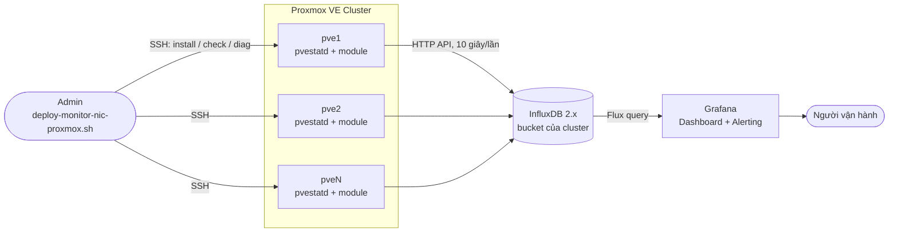
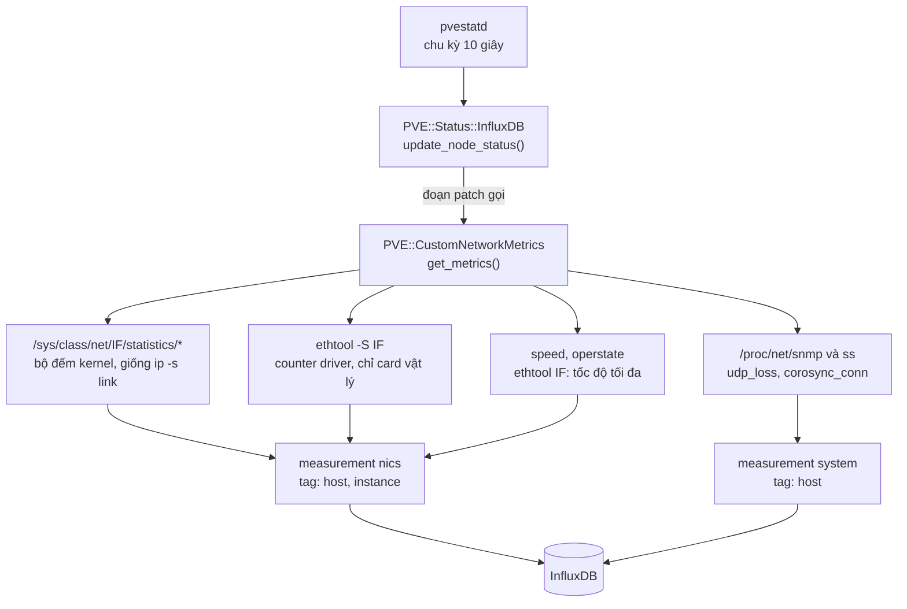
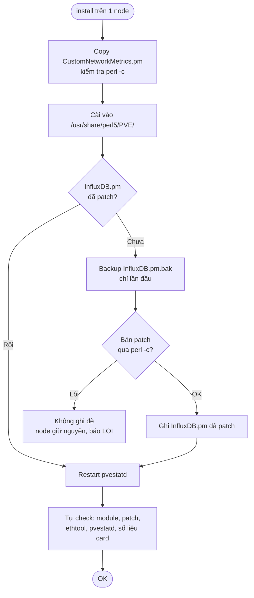
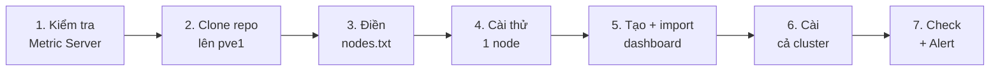
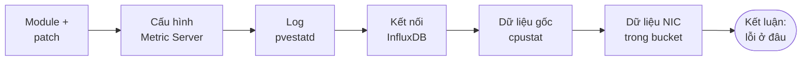

<div align="center">

# 📡 Proxmox Cluster NIC Monitor

### Giám sát card mạng Proxmox VE bằng InfluxDB & Grafana — không cần agent

Thu thập đầy đủ thông số như `ip -s link` và `ethtool -S`, trạng thái UP/DOWN và tốc độ link card 10G/25G trên **mọi node** của cluster,
đẩy thẳng vào InfluxDB qua `pvestatd` có sẵn của Proxmox và hiển thị trên Grafana.


-22ADF6?logo=influxdb&logoColor=white)


[Giới thiệu](#-giới-thiệu) •
[Kiến trúc](#-kiến-trúc) •
[Thông số](#-thông-số-thu-thập) •
[Cài đặt](#-cài-đặt-nhanh) •
[Dashboard](#-dashboard-grafana) •
[Vận hành](#-vận-hành) •
[Tài liệu](#-tài-liệu-chi-tiết)

</div>

---

## 📖 Giới thiệu

Metric mặc định mà Proxmox gửi sang InfluxDB chỉ có **băng thông TX/RX**. Khi cluster gặp sự cố mạng như cáp lỗi, SFP bẩn, link chập chờn hay card 25G chạy tụt xuống 10G, dashboard thường **không thấy gì bất thường**.

Dự án này bổ sung các chỉ số mạng ở mức thấp vào ngay luồng metric gốc của Proxmox:

| Vấn đề thường gặp | Dự án này giúp thấy được |
|---|---|
| Cáp/DAC hỏng, SFP bẩn | `rx_crc_errors`, `port.rx_crc_errors` tăng theo thời gian |
| Link chập chờn (flapping) | Timeline UP/DOWN từng card |
| Card 25G chỉ chạy 10G | So sánh `link_speed` với `link_speed_max` |
| Ring buffer đầy, CPU không kịp | `rx_missed_errors`, `rx_fifo_errors` |
| Corosync mất ổn định | `udp_loss`, `corosync_conn` |

**Điểm mạnh:**

- ✅ **100% native:** chạy trong `pvestatd` của Proxmox, không cài Telegraf, node_exporter hay vòng lặp bash.
- ✅ **Triển khai hàng loạt:** một lệnh cài cho cả cluster qua SSH.
- ✅ **An toàn:** kiểm tra `perl -c` trước khi ghi, có backup `.bak`, chạy lại không bị chèn trùng, gỡ sạch được.
- ✅ **Tự chẩn đoán:** lệnh `diag` chỉ ra lỗi nằm ở module, cấu hình, kết nối hay InfluxDB.
- ✅ **Dashboard sẵn:** tự sinh đúng bucket và datasource cho từng cluster.

---

## 🏗 Kiến trúc

### Tổng quan hệ thống



### Luồng thu thập trên mỗi node



Script chỉ **chèn một đoạn nhỏ** vào hàm `update_node_status` trong `/usr/share/perl5/PVE/Status/InfluxDB.pm`, không ghi đè cả file, nên dùng được với nhiều phiên bản Proxmox. Module bắt mọi lỗi bên trong, nên nếu đọc số liệu lỗi thì `pvestatd` vẫn chạy bình thường.

### Script làm gì khi `install`



---

## 📊 Thông số thu thập

### Card mạng — measurement `nics`

Tag: `host` (tên node), `instance` (tên card, ví dụ `enp24s0f2np2`).

<details open>
<summary><b>Bộ đếm kernel (giống <code>ip -s link</code>)</b></summary>

| `ip -s link` | Field |
|---|---|
| RX bytes / packets | `rx_bytes`, `rx_packets` |
| RX errors / dropped / missed / mcast | `rx_errors`, `rx_dropped`, `rx_missed_errors`, `multicast` |
| TX bytes / packets | `tx_bytes`, `tx_packets` |
| TX errors / dropped / carrier / collsns | `tx_errors`, `tx_dropped`, `tx_carrier_errors`, `collisions` |
| Chi tiết lỗi | `rx_crc_errors`, `rx_length_errors`, `rx_over_errors`, `rx_fifo_errors`, `rx_frame_errors`, `rx_nohandler`, `tx_aborted_errors`, `tx_fifo_errors`, `tx_heartbeat_errors`, `tx_window_errors` |

</details>

<details open>
<summary><b>Counter driver (<code>ethtool -S</code>, chỉ card vật lý)</b></summary>

Mỗi tên có thêm tiền tố `ethtool_`, ký tự đặc biệt đổi thành `_`.

| `ethtool -S` | Field |
|---|---|
| `rx_crc_errors` | `ethtool_rx_crc_errors` |
| `veb.rx_discards` | `ethtool_veb_rx_discards` |
| `port.rx_crc_errors` | `ethtool_port_rx_crc_errors` |
| `port.tx_dropped_link_down` | `ethtool_port_tx_dropped_link_down` |

- Chỉ lấy counter có tên chứa *err, drop, discard, crc, miss, timeout, length, fifo, over, collision, carrier…*
- Bỏ counter theo từng queue (`rx_queue_0_*`, `tx-0.*`) để InfluxDB không bị phình.

</details>

<details open>
<summary><b>Trạng thái và tốc độ link</b></summary>

| Field | Ý nghĩa |
|---|---|
| `network_up` | `1` = UP, `0` = DOWN |
| `link_speed` | Tốc độ hiện tại (Mb/s), `0` khi DOWN |
| `link_speed_max` | Tốc độ tối đa card hỗ trợ (Mb/s). Card 10G luôn là `10000`, kể cả khi DOWN |
| `hardware_drop` | Số gói rớt (RX dropped) |

</details>

Card ảo (`tap*`, `veth*`, `fwbr*`, `fwpr*`, `fwln*`) chỉ lấy trạng thái UP/DOWN, không lấy bộ đếm lỗi.

### Hệ thống — measurement `system`

| Field | Ý nghĩa |
|---|---|
| `udp_loss` | Số gói UDP lỗi/rớt (`InErrors` trong `/proc/net/snmp`) |
| `udp_total` | Tổng gói UDP đã nhận (`InDatagrams`) |
| `corosync_conn` | Số kết nối Corosync đang hoạt động (cổng 5404/5405) |

---

## ✅ Yêu cầu

| Thành phần | Yêu cầu |
|---|---|
| Proxmox VE | Đã cấu hình **Datacenter → Metric Server** loại **InfluxDB**, đang bật |
| InfluxDB | 2.x, có bucket, org và token ghi dữ liệu |
| Grafana | Datasource InfluxDB, ngôn ngữ truy vấn **Flux**, trỏ tới bucket trên |
| Trên node | Quyền `root`, có `ethtool` |
| SSH | Từ node chạy script tới các node: SSH key, hoặc mật khẩu + `sshpass` |

---

## 📁 Cấu trúc repo

```
monitor-grafana-proxmox-cluster-influxdb/
├── deploy/                           # Bộ cài: copy nguyên thư mục này lên node
│   ├── CustomNetworkMetrics.pm       # Module Perl thu thập số liệu
│   ├── deploy-monitor-nic-proxmox.sh # install / check / diag / dashboard / uninstall
│   ├── nodes.txt                     # Danh sách IP node (điền IP của bạn)
│   └── dashboard-template.json       # Dashboard Grafana mẫu
└── docs/
    ├── Huong-Dan-Trien-Khai.md       # Hướng dẫn từng bước — bắt đầu ở đây
    ├── Canh-Bao-Va-Xu-Ly-Su-Co.md    # Alert Grafana, đọc lỗi, xử lý sự cố, vận hành
    └── Cai-Dat-Thu-Cong.md           # Patch thủ công, giải thích nguyên lý
```

> Cả 4 file trong `deploy/` phải nằm **cùng một thư mục** trên node, vì script tìm các file còn lại ngay cạnh nó.

---

## 🚀 Cài đặt nhanh

### Quy trình



### Các lệnh

Chạy trên node đầu tiên của cluster bằng `root`:

```bash
# 1. Lấy bộ cài
apt install -y git ethtool
git clone https://github.com/fixnhanh-linux/monitor-grafana-proxmox-cluster-influxdb.git /root/nic-monitor
cd /root/nic-monitor/deploy
chmod +x deploy-monitor-nic-proxmox.sh

# 2. Khai báo IP các node, mỗi dòng 1 IP
pvecm status | sed -n '/Membership information/,$p'
nano nodes.txt

# 3. Cài thử 1 node, output phải toàn [OK]
./deploy-monitor-nic-proxmox.sh install 10.0.0.11

# 4. Tạo dashboard đúng bucket của cluster (đọc từ /etc/pve/status.cfg)
./deploy-monitor-nic-proxmox.sh dashboard

# 5. Cài cho cả cluster rồi kiểm tra
./deploy-monitor-nic-proxmox.sh install -f nodes.txt
./deploy-monitor-nic-proxmox.sh check   -f nodes.txt
```

Kết quả mẫu khi cài thành công:

```
==> 10.0.0.11 (install)
[pve1]
  [OK] Da cai /usr/share/perl5/PVE/CustomNetworkMetrics.pm
  [OK] Da patch InfluxDB.pm (backup: /usr/share/perl5/PVE/Status/InfluxDB.pm.bak)
  [OK] Co ethtool
  [OK] pvestatd dang chay
  udp_loss=0 corosync_conn=4
  enp24s0f2np2     UP    10000/10000  rx_errors=67 rx_dropped=685 tx_dropped=878 rx_crc=67 (+17 counter ethtool)
Hoan thanh: 1 node OK
```

> **Node không có Internet?** Tải `monitor-nic-proxmox.zip` ở mục **Releases**, `scp` lên node rồi giải nén. Xem [Hướng dẫn triển khai, bước 2](docs/Huong-Dan-Trien-Khai.md).

### Import dashboard

Lệnh `dashboard` tạo file `dashboard-<bucket>.json`. Có hai cách đưa vào Grafana:

```bash
# Cách 1: script import luôn (token: Administration → Service accounts → role Editor)
export GRAFANA_URL=https://<IP-Grafana>:3000
export GRAFANA_TOKEN='glsa_xxx'
export GRAFANA_DS='ten-datasource-influxdb'   # tùy chọn
./deploy-monitor-nic-proxmox.sh dashboard

# Cách 2: import tay — copy file về máy rồi Dashboards → New → Import → Upload
```

---

## 🧰 Các lệnh của script

| Lệnh | Tác dụng |
|---|---|
| `install [-f nodes.txt \| ip...]` | Cài module, patch `InfluxDB.pm` (có backup), restart `pvestatd`, tự kiểm tra |
| `check [-f nodes.txt \| ip...]` | Kiểm tra module, patch, ethtool, pvestatd và in số liệu từng card |
| `diag [-f nodes.txt \| ip...]` | Chẩn đoán vì sao Grafana không có số liệu |
| `dashboard [bucket]` | Tạo `dashboard-<bucket>.json`; có `GRAFANA_URL` + `GRAFANA_TOKEN` thì import luôn |
| `uninstall [-f nodes.txt \| ip...]` | Khôi phục `InfluxDB.pm` gốc, xóa module, restart `pvestatd` |

Không truyền node thì script dùng `nodes.txt` nằm cạnh script.

| Biến môi trường | Mặc định | Ý nghĩa |
|---|---|---|
| `SSH_USER` | `root` | User SSH tới các node |
| `SSH_PASS` | (trống) | Mật khẩu SSH, cần cài `sshpass` |
| `GRAFANA_URL` | (trống) | URL Grafana để import dashboard |
| `GRAFANA_TOKEN` | (trống) | Token service account Grafana |
| `GRAFANA_DS` | (trống) | Tên datasource InfluxDB gắn vào dashboard |

### Lệnh `diag` kiểm tra những gì



---

## 📈 Dashboard Grafana

Dashboard giữ các panel tổng quan của Proxmox (CPU, RAM, storage, VM) và thêm nhóm panel NIC. Các panel NIC **chỉ hiện card vật lý**, không hiện `vmbr*`, `bond*`, `br-*`, `docker0`.

| Panel | Kiểu | Nội dung |
|---|---|---|
| Physical NIC Link Status (10G+) | Stat | Card 10G trở lên, tên kèm tốc độ tối đa (`[25G]`), giá trị là tốc độ hiện tại |
| NIC Link Status Timeline | State timeline | UP/DOWN và tốc độ từng card theo thời gian, thấy rõ lúc link flap |
| NIC Error Timeline | State timeline | Xanh `OK` = không có lỗi mới, đỏ = số lỗi mới trong khoảng đó |
| NIC Counters - ip -s link | Bảng | Đủ cột như `ip -s link`, ô lỗi khác 0 tô đỏ |
| NIC RX Errors - CRC / Length / Missed / Overrun | Cột | Lỗi RX mới mỗi khoảng thời gian |
| NIC Drops & TX Errors | Cột | Gói rớt và lỗi TX mới mỗi khoảng thời gian |
| NIC Driver Counters - ethtool -S | Bảng + cột | Counter driver khác 0, và counter đang tăng |
| Corosync Connections, UDP Packet Loss | Stat | Sức khỏe mạng cluster |

**Màu tốc độ link:** 🟢 UP từ 10G · 🟠 UP nhưng dưới 10G (kiểm tra cáp/SFP/port switch) · 🔴 DOWN

> 💡 **Cách đọc số:** số tích lũy (ví dụ `rx_errors = 67`) có thể là lỗi cũ từ lần boot trước. Hãy xem các biểu đồ **"new per interval"** để biết lỗi **còn đang phát sinh** hay không.

---

## 🔔 Cảnh báo

Nên tạo hai Alert rule trong Grafana. Truy vấn Flux đầy đủ có trong [Cảnh báo và xử lý sự cố](docs/Canh-Bao-Va-Xu-Ly-Su-Co.md#1-cảnh-báo-grafana-alerting).

| Cảnh báo | Điều kiện |
|---|---|
| Card 10G mất link | `network_up` của card có `link_speed_max >= 10000` nhỏ hơn 1 trong 1 phút |
| Lỗi CRC / RX errors đang tăng | Tổng lỗi mới trong 15 phút lớn hơn 0 (hoặc ngưỡng 10) |

---

## 🛠 Vận hành

> ⚠️ **Quan trọng:** mỗi lần `apt upgrade` có nâng cấp `pve-manager`, file `InfluxDB.pm` sẽ bị ghi đè và **mất patch**. Dấu hiệu: panel NIC không còn dữ liệu mới, trong khi CPU/RAM vẫn bình thường.

```bash
./deploy-monitor-nic-proxmox.sh check   -f nodes.txt   # node nào báo [THIEU] là đã mất patch
./deploy-monitor-nic-proxmox.sh install -f nodes.txt   # chạy lại luôn an toàn
```

| Tình huống | Việc cần làm |
|---|---|
| Thêm node mới | Thêm IP vào `nodes.txt`, chạy `install <ip-node-moi>` |
| Sửa module | Sửa `CustomNetworkMetrics.pm`, kiểm tra `perl -c`, chạy lại `install` |
| InfluxDB báo timeout | Tăng timeout ở **Datacenter → Metric Server → Edit** |
| Gỡ bỏ | `./deploy-monitor-nic-proxmox.sh uninstall -f nodes.txt` |

### Sự cố thường gặp

| Hiện tượng | Cách xử lý |
|---|---|
| `$'\r': command not found` | File bị đổi sang CRLF khi copy qua Windows: `sed -i 's/\r$//' *.sh *.pm` |
| `Permission denied` khi SSH | `ssh-copy-id root@<ip>`, hoặc `export SSH_PASS='...'` và cài `sshpass` |
| Không có field `ethtool_*` | `apt install ethtool` rồi chạy lại `install` |
| Dashboard trống | Chọn đúng Datasource/bucket, rồi chạy `diag -f nodes.txt` |

Bảng đầy đủ: [Cảnh báo và xử lý sự cố](docs/Canh-Bao-Va-Xu-Ly-Su-Co.md).

---

## 📚 Tài liệu chi tiết

| Tài liệu | Nội dung |
|---|---|
| [Hướng dẫn triển khai](docs/Huong-Dan-Trien-Khai.md) | Từng bước từ kiểm tra Metric Server tới cài toàn cluster, kết quả đúng và cách sửa ở mỗi bước |
| [Cảnh báo và xử lý sự cố](docs/Canh-Bao-Va-Xu-Ly-Su-Co.md) | Alert Grafana, ý nghĩa từng loại lỗi card mạng, quy trình xử lý lỗi CRC, vận hành, checklist |
| [Cài đặt thủ công](docs/Cai-Dat-Thu-Cong.md) | Patch tay `InfluxDB.pm`, giải thích nguyên lý hoạt động |

---

<div align="center">

**Không commit token Grafana/InfluxDB hay IP thật vào repo.**

Nếu thấy hữu ích, hãy cho repo một ⭐

</div>
