# Hướng dẫn triển khai Monitor card mạng (NIC) Proxmox

Thu thập đầy đủ các thông số như lệnh `ip -s link` và `ethtool -S` trên từng node Proxmox. Dữ liệu được đẩy vào InfluxDB qua `pvestatd`, rồi hiển thị trên dashboard Grafana **Proxmox Cluster**.

## 1. Các file của bộ cài

| File | Vai trò |
|---|---|
| `install.sh` | **Cài cả cluster bằng 1 lệnh**: hỏi InfluxDB (cập nhật Metric Server), tự lấy IP node, cài, kiểm tra, rồi hỏi Grafana và tên dashboard để import |
| `deploy/CustomNetworkMetrics.pm` | Module Perl thu thập số liệu, được cài vào `/usr/share/perl5/PVE/` trên node |
| `deploy/deploy-monitor-nic-proxmox.sh` | Script cài, kiểm tra, chẩn đoán và gỡ trên nhiều node qua SSH |
| `deploy/nodes.txt` | Danh sách IP các node, mỗi dòng 1 IP (`install.sh` tự điền nếu để trống) |
| `dashboard-grafana/proxmox-cluster-dashboard.json` | Dashboard Grafana mẫu (file duy nhất) |
| `dashboard-grafana/import-dashboard.sh` | Hỏi InfluxDB → Grafana → datasource (chọn hoặc tạo mới) → tên dashboard, rồi import qua API Grafana |
| `dashboard-grafana/influx-common.sh` | Hàm dùng chung: hỏi và kiểm tra thông tin InfluxDB |
| `dashboard-grafana/export-dashboard.sh` | Lấy dashboard đang chạy trên Grafana, làm sạch, lưu lại vào repo |

Nên `git clone` **cả repo** lên node: script trong `deploy/` dùng file dashboard ở `dashboard-grafana/`.

> **Cách nhanh nhất:** sau Bước 1 và Bước 2, chạy `bash /root/monitor-grafana-proxmox-cluster-influxdb/install.sh` là xong Bước 3 tới Bước 8. Các bước dưới đây là cách làm từng bước để hiểu và xử lý khi có lỗi.

## 2. Cách hoạt động



Script chỉ chèn một đoạn vào `update_node_status` trong file `/usr/share/perl5/PVE/Status/InfluxDB.pm`. Script không ghi đè cả file, nên dùng được với mọi phiên bản Proxmox.

## 3. Thông số thu thập

**Bộ đếm kernel (giống `ip -s link`)**: field có tên giống hệt tên file trong `/sys/class/net/<if>/statistics/`.

| `ip -s link` | Field |
|---|---|
| RX bytes / packets | `rx_bytes`, `rx_packets` |
| RX errors / dropped / missed / mcast | `rx_errors`, `rx_dropped`, `rx_missed_errors`, `multicast` |
| TX bytes / packets | `tx_bytes`, `tx_packets` |
| TX errors / dropped / carrier / collsns | `tx_errors`, `tx_dropped`, `tx_carrier_errors`, `collisions` |
| Chi tiết lỗi | `rx_crc_errors`, `rx_length_errors`, `rx_over_errors`, `rx_fifo_errors`, `rx_frame_errors`, `rx_nohandler`, `tx_aborted_errors`, `tx_fifo_errors`, `tx_heartbeat_errors`, `tx_window_errors` |

**Counter của driver (`ethtool -S`)**: mỗi tên có thêm tiền tố `ethtool_`, các ký tự đặc biệt đổi thành `_`.

| `ethtool -S` | Field |
|---|---|
| `rx_crc_errors` | `ethtool_rx_crc_errors` |
| `veb.rx_discards` | `ethtool_veb_rx_discards` |
| `port.rx_crc_errors` | `ethtool_port_rx_crc_errors` |
| `port.tx_dropped_link_down` | `ethtool_port_tx_dropped_link_down` |
| `port.tx_hwtstamp_timeouts` | `ethtool_port_tx_hwtstamp_timeouts` |

- Chỉ lấy counter có tên chứa err, drop, discard, crc, miss, timeout, length, fifo, over, collision, carrier…
- Bỏ counter theo từng queue (`rx_queue_0_*`, `tx-0.*`) để InfluxDB không bị phình dữ liệu.
- Card ảo (`tap*`, `veth*`, `fwbr*`, `fwpr*`, `fwln*`) chỉ lấy trạng thái UP/DOWN, không lấy bộ đếm lỗi.

**Trạng thái và tốc độ link (chỉ card vật lý):**

| Field | Ý nghĩa |
|---|---|
| `network_up` | 1 = UP, 0 = DOWN |
| `link_speed` | Tốc độ link hiện tại (Mb/s), 0 khi DOWN. Lấy từ `/sys/class/net/<if>/speed` |
| `link_speed_max` | Tốc độ tối đa card hỗ trợ (Mb/s), lấy từ "Supported link modes" của `ethtool <if>`. Card 10G có giá trị `10000` kể cả khi đang DOWN |

`pvestatd` chạy liên tục, nên `link_speed_max` chỉ đọc bằng `ethtool` một lần cho mỗi card. Nếu driver không báo link mode thì dùng tốc độ cao nhất từng thấy. Trường hợp card DOWN ngay từ lúc `pvestatd` khởi động mà driver lại không báo link mode, card đó sẽ chưa hiện trên panel 10G cho tới khi có link.
- Các field cũ `hardware_drop`, `network_up`, `udp_loss`, `udp_total`, `corosync_conn` vẫn giữ nguyên tên.

**Corosync (measurement `system`), đọc từ `corosync-cfgtool -s`:**

| Field | Ý nghĩa |
|---|---|
| `corosync_links` | Số link Corosync đang cấu hình (link0, link1…) |
| `corosync_links_up` | Số link tới được **mọi** node khác. Cluster 2 link khỏe = `2` |
| `corosync_link<N>_peers` / `_connected` | Số node khác / số node kết nối được qua link N |
| `corosync_link<N>_up` | `1` = link N tới được mọi node |
| `corosync_link<N>_iface` | Interface đang giữ IP của link N, ví dụ `vlan3001`, `vmbr0`, `nic2` |
| `corosync_link<N>_addr` | IP của node trên link N (từ `corosync-cfgtool -s`) |
| `corosync_link<N>_nics` | Card vật lý thật bên dưới interface (dò qua VLAN → bond/bridge → card), ví dụ `ens3f0np0+ens3f1np1` |
| `corosync_link<N>_speed` | Tốc độ (Mb/s) của card vật lý đang UP bên dưới, để biết link chạy 10G hay 1G |

`corosync_conn` chỉ đếm socket UDP cổng 5404/5405, không cho biết link có thông. Dùng `corosync_links_up` để giám sát.

## 4. Setup từng bước

Quy ước: dùng node đầu tiên `10.0.0.11` (pve1) làm nơi chạy script cho cả cluster. Các node trong cùng cluster đã SSH được sang nhau, nên thường không cần cấu hình SSH thêm. Thay IP và tên card cho đúng hệ thống.


| Bước | Việc cần làm | Làm ở đâu |
|---|---|---|
| 1 | Kiểm tra Metric Server | Giao diện web Proxmox |
| 2 | Lấy bộ cài lên pve1 (git clone hoặc file zip) | pve1 hoặc máy Windows |
| 3 | Chuẩn bị | pve1 (SSH) |
| 4 | Khai báo node, kiểm tra SSH | pve1 (SSH) |
| 5 | Cài thử trên pve1 | pve1 (SSH) |
| 6 | Tạo dashboard đúng bucket, import, kiểm tra pve1 | pve1 (SSH) và Grafana |
| 7 | Cài toàn cluster | pve1 (SSH) |
| 8 | Kiểm tra toàn cluster | pve1 (SSH) và Grafana |
| 9 | Cảnh báo (tùy chọn) | Grafana |

### Bước 1: Kiểm tra Metric Server (giao diện web Proxmox)

**Datacenter → Metric Server** phải có một dòng **InfluxDB**, **Enabled = Yes**, bucket `proxmox-cluster-deco`.

- **Kết quả đúng:** có dòng InfluxDB đang bật, hoặc dashboard đang có số liệu CPU/RAM.
- **Nếu chưa có:** **Add → InfluxDB**, nhập Server, Port, Organization, Bucket, Token rồi **Create**.

### Bước 2: Lấy bộ cài lên pve1

**Cách A: node có Internet** (SSH vào pve1):

```bash
apt install -y git
git clone https://github.com/fixnhanh-linux/monitor-grafana-proxmox-cluster-influxdb.git /root/monitor-grafana-proxmox-cluster-influxdb
ln -sfn /root/monitor-grafana-proxmox-cluster-influxdb/deploy /root/monitor-nic-proxmox
```

**Cách B: node không có Internet**: tải `monitor-nic-proxmox.zip` ở mục **Releases** của repo (hoặc tự nén 3 file trong `deploy/` cùng `dashboard-grafana/import-dashboard.sh` và `dashboard-grafana/proxmox-cluster-dashboard.json` vào chung một thư mục), rồi copy lên pve1 từ máy Windows (PowerShell):

```powershell
scp monitor-nic-proxmox.zip root@10.0.0.11:/root/
```

Lần đầu hỏi `yes/no` thì gõ `yes`, rồi nhập mật khẩu root. Không có `scp` thì dùng WinSCP kéo thả file vào `/root/`.

### Bước 3: Chuẩn bị (SSH vào pve1)

`ssh root@10.0.0.11`. Từ đây mọi lệnh chạy trên pve1. Nếu dùng **cách B**, giải nén trước:

```bash
command -v unzip || apt install -y unzip
unzip -o /root/monitor-nic-proxmox.zip -d /root/monitor-nic-proxmox
```

Sau đó (cả hai cách):

```bash
cd /root/monitor-nic-proxmox
chmod +x deploy-monitor-nic-proxmox.sh
ls -l
command -v ethtool || apt install -y ethtool
```

- **Kết quả đúng:** `ls -l` có `CustomNetworkMetrics.pm`, `deploy-monitor-nic-proxmox.sh` (quyền `-rwxr-xr-x`), `nodes.txt`; lệnh cuối in `/usr/sbin/ethtool`.
- **Nếu lỗi:** `unzip` báo `End-of-central-directory signature not found` là file hỏng khi copy, copy lại. Node không có Internet để `apt install unzip` thì copy 4 file lẻ bằng WinSCP vào `/root/monitor-nic-proxmox/`. Báo `$'\r': command not found` thì chạy `sed -i 's/\r$//' *.sh *.pm`.

### Bước 4: Khai báo node và kiểm tra SSH (pve1)

Lấy IP các node:

```bash
pvecm status | sed -n '/Membership information/,$p'
```

Điền IP vào `nodes.txt`, mỗi dòng một IP (lưu: Ctrl+O, Enter; thoát: Ctrl+X):

```bash
nano nodes.txt
```

Kiểm tra SSH không cần mật khẩu (chạy trong `/root/monitor-nic-proxmox`):

```bash
for ip in $(awk 'NF && $1 !~ /^#/ {print $1}' nodes.txt); do
  echo -n "$ip -> "; ssh -o BatchMode=yes -o ConnectTimeout=5 root@$ip hostname
done
```

- **Kết quả đúng:** mỗi IP in đúng tên node.
- **Nếu lỗi `Permission denied`:** `ssh-copy-id root@<ip>`, hoặc `apt install sshpass` rồi `export SSH_PASS='mat_khau'`.

### Bước 5: Cài thử trên pve1 (pve1)

Ghi lại số liệu gốc để đối chiếu:

```bash
ip -s link show enp24s0f2np2
```

Cài:

```bash
./deploy-monitor-nic-proxmox.sh install 10.0.0.11
```

Kết quả mẫu:

```
==> 10.0.0.11 (install)
[pve1]
  [OK] Da cai /usr/share/perl5/PVE/CustomNetworkMetrics.pm
  [OK] Da patch InfluxDB.pm (backup: /usr/share/perl5/PVE/Status/InfluxDB.pm.bak)
  [OK] Co /usr/share/perl5/PVE/CustomNetworkMetrics.pm
  [OK] InfluxDB.pm da duoc patch
  [OK] Co ethtool
  [OK] pvestatd dang chay
  udp_loss=0 corosync_conn=2
  corosync: 2/2 link UP
    link0  UP   2/2 node ket noi  ip=10.30.1.11  iface=vlan3001  card=ens3f0np0+ens3f1np1  10G
    link1  UP   2/2 node ket noi  ip=10.10.10.1  iface=nic2  card=nic2  1G
  enp24s0f2np2     UP    10000/10000  rx_errors=67 rx_dropped=685 tx_dropped=878 rx_crc=67 (+17 counter ethtool)
Hoan thanh: 1 node OK
```

- **Kết quả đúng:** mọi dòng `[OK]`; số liệu khớp `ip -s link`.
- **Nếu có `[LOI]`:** xem [bảng sự cố khi triển khai](02-Canh-Bao-Va-Xu-Ly-Su-Co-Card-Mang.md#3-sự-cố-khi-triển-khai). Nếu lỗi ở bước patch, script không ghi đè `InfluxDB.pm`.

### Bước 6: Tạo dashboard đúng bucket và import (pve1, Grafana)

Dashboard mẫu dùng bucket `proxmox-cluster-deco`. Mỗi cluster có thể gửi vào bucket khác (xem `cat /etc/pve/status.cfg`, dòng `bucket`), nên tạo dashboard riêng cho cluster bằng lệnh `dashboard`. Lệnh tự đọc bucket từ `status.cfg`:

```bash
cd /root/monitor-nic-proxmox
./deploy-monitor-nic-proxmox.sh dashboard
```

Lệnh này gọi `dashboard-grafana/import-dashboard.sh`. Kết quả: file `dashboard-grafana/dashboard-<bucket>.json` (ví dụ `dashboard-demo.json`), title `Proxmox Cluster <bucket>`, uid riêng nên không ghi đè dashboard của cluster khác. Mọi panel dùng biến datasource, không gắn cứng datasource của Grafana cũ. Chạy trên terminal, script hỏi lần lượt: thông tin InfluxDB (mặc định lấy từ Metric Server), URL và token Grafana (bắt buộc, sai thì nhập lại), datasource (chọn datasource khớp InfluxDB hoặc tạo mới), cuối cùng là tên dashboard.

**Cách 1: script hỏi rồi import luôn** (cần token Grafana: Administration → Service accounts → Add, role **Admin** nếu cần tạo datasource → Add token):

```bash
./deploy-monitor-nic-proxmox.sh dashboard
```

Chạy không hỏi thì đặt trước `INFLUX_URL`, `INFLUX_ORG`, `INFLUX_TOKEN`, `GRAFANA_URL`, `GRAFANA_TOKEN`, `DASH_TITLE` (xem [hướng dẫn import dashboard](../dashboard-grafana/Huong-Dan-Import-Dashboard-Grafana.md)).

**Cách 2: import tay:** copy file về Windows rồi Dashboards → New → Import → Upload:

```powershell
scp root@10.0.0.11:/root/monitor-grafana-proxmox-cluster-influxdb/dashboard-grafana/dashboard-demo.json .
```

Mở dashboard, chọn **Datasource** (datasource InfluxDB Flux trỏ tới bucket của cluster), **Server** = pve1, thời gian **Last 15 minutes**.

- **Kết quả đúng:** panel "NIC Link Status" hiện mọi card vật lý (kể cả card 1G), panel "Corosync Links" hiện `✔ 2 of 2 links UP` nếu cluster có 2 link; các bảng "NIC Link & Traffic / RX Errors / TX Errors (Since Boot)" khớp `ip -s link`.
- **Nếu trống:** kiểm tra đã chọn đúng Datasource, đợi thêm 1 phút, chạy `./deploy-monitor-nic-proxmox.sh check <ip-pve1>`.

### Bước 7: Cài toàn cluster (pve1)

```bash
./deploy-monitor-nic-proxmox.sh install -f nodes.txt
```

- **Kết quả đúng:** `Hoan thanh: 8 node OK`.
- **Nếu có node lỗi:** đọc output của node đó, sửa, chạy lại riêng: `./deploy-monitor-nic-proxmox.sh install <ip>`.

### Bước 8: Kiểm tra toàn cluster (pve1 và Grafana)

```bash
./deploy-monitor-nic-proxmox.sh check -f nodes.txt
```

Mọi node `[OK]`; trên Grafana đổi Server qua từng node đều có số liệu.

Không truyền tham số (`./deploy-monitor-nic-proxmox.sh check`) thì script tự dùng `nodes.txt` nằm cùng thư mục với script, chạy ở thư mục nào cũng được. Khi dùng `-f` thì phải có tên file ngay sau: `-f nodes.txt`.

### Chẩn đoán khi Grafana không có số liệu

```bash
./deploy-monitor-nic-proxmox.sh diag -f nodes.txt
```


Lệnh chạy trên từng node, tự đọc cấu hình InfluxDB (server, port, org, bucket, token) trong Proxmox rồi kiểm tra lần lượt: module/patch → cấu hình Metric Server (cảnh báo timeout quá ngắn) → log `pvestatd` → kết nối InfluxDB → dữ liệu gốc (`cpustat`) và dữ liệu NIC mới trong bucket. Dòng **Ket luan** cuối cùng cho biết lỗi nằm ở đâu và cách xử lý.

### Bước 9: Cảnh báo (tùy chọn)

Xem [Cảnh báo và xử lý sự cố](02-Canh-Bao-Va-Xu-Ly-Su-Co-Card-Mang.md#1-cảnh-báo-grafana-alerting).



**Script làm gì trên mỗi node:** cài module vào `/usr/share/perl5/PVE/`, backup `InfluxDB.pm` thành `.bak` (chỉ lần đầu), patch `InfluxDB.pm` nếu chưa patch (kiểm tra `perl -c`, lỗi thì không ghi đè), restart `pvestatd`, rồi tự kiểm tra.

## 5. Kiểm tra

**Trên các node:**

```bash
./deploy-monitor-nic-proxmox.sh check -f nodes.txt
```

**Xem log pvestatd trên node:**

```bash
journalctl -u pvestatd -n 50
```

**Kiểm tra dữ liệu trong InfluxDB** (Data Explorer, Flux):

```flux
from(bucket: "proxmox-cluster-deco")
  |> range(start: -5m)
  |> filter(fn: (r) => r._measurement == "nics" and r.instance == "enp24s0f2np2")
  |> last()
```

## 6. Dashboard Grafana

Import `dashboard-<bucket>.json` do lệnh `dashboard` tạo (Bước 6). Mọi panel NIC đều bằng tiếng Anh và **chỉ hiện card vật lý** (card có `link_speed_max`), không hiện `br-*`, `docker0`, `ovs-system`, `vmbr*`, `bond*`.

| Panel | Kiểu | Nội dung |
|---|---|---|
| NIC Link Status | State timeline | Mỗi card vật lý một thanh (1G, 10G, 25G…), tên kèm tốc độ tối đa (`nic2 [1G]`). `✔ UP 10G` (xanh, đúng tốc độ tối đa của card) · `▲ UP 10G (below max)` (cam) · `⚠ … · 1–99 Errors` (vàng) · `▲ … · 100–999 Errors` (cam) · `⛔ … · 1K+ Errors` / `⛔ DOWN` (đỏ) |
| NIC Link Speed | Time series | Tốc độ link theo thời gian, vạch nét đứt ở 10G. Tụt về 0 = DOWN, bước xuống = đổi tốc độ. Cột `Min` = 0 nghĩa là đã có lúc rớt link |
| Corosync Links | Stat | Số link Corosync tới được mọi node: `✔ 2 of 2 links UP` (xanh) · `▲ 1 of 2 links UP` (cam, một link mất node, cluster vẫn chạy trên link còn lại) · `⛔ 0 of 2 links UP` (đỏ) |
| Corosync Link Health | Time series | Mỗi link một đường cong mượt = **% số node kết nối được** qua link đó (100% = thông tới mọi node, 0% = DOWN). Nền tô dải xanh (100%) · cam (mất một phần node) · đỏ (0%). Tên đường ghi rõ link chạy qua đâu: `link0 · vlan3001 → ens3f0np0+ens3f1np1 · 10G`, `link1 · nic2 → nic2 · 1G`; node không có IP của link thì là `<ip> · no local IP`. Bảng chú thích có Last và Min (Min = 0% là link đã từng rớt) |
| UDP Packet Loss | Stat | Gói UDP lỗi/rớt trên node |
| Hardware RX Drops (Cumulative) | Time series | Gói RX bị rớt (tích lũy) theo từng interface |
| NIC Link & Traffic (Since Boot) | Bảng | Link, Speed, Max Speed, RX/TX Bytes, RX/TX Packets, Multicast. Link/Speed tô màu theo trạng thái |
| NIC RX Errors (Since Boot) | Bảng | Errors, CRC, Length, Missed, Dropped, Overrun, FIFO, Frame, No Handler |
| NIC TX Errors (Since Boot) | Bảng | Errors, Dropped, Carrier, Aborted, FIFO, Heartbeat, Window, Collisions |
| NIC RX Errors (Per Interval) | Cột chồng | Lỗi RX **mới** mỗi khoảng thời gian, tên dạng `ens3f0np0 · CRC`, bảng chú thích xếp theo Total giảm dần |
| NIC TX Errors & Drops (Per Interval) | Cột chồng | Lỗi TX và gói rớt **mới** mỗi khoảng thời gian |
| Ethtool Counters (Since Boot) | Bảng | Counter `ethtool -S` khác 0 (bỏ tiền tố `ethtool_`), cột Count dạng thanh đo màu |
| Ethtool Counters (Per Interval) | Cột | Mức tăng của các counter `ethtool` khác 0; đường phẳng ở 0 = không tăng |

**Mức cảnh báo (bảng lỗi và counter):** 🟩 0 = OK · 🟨 1–99 = chú ý · 🟧 100–999 = cảnh báo · 🟥 1.000–9.999 = nghiêm trọng · đỏ đậm ≥ 10.000.

**Màu tốc độ link:** xanh lá = UP từ 10G · cam = UP nhưng dưới 10G (kiểm tra cáp/SFP/port switch) · đỏ = DOWN. Card 25G chạy ở 10G hiện `UP 10G`, tên có `[25G]` để phân biệt.

Mỗi panel có nút ⓘ giải thích bằng tiếng Anh ý nghĩa và nguyên nhân thường gặp của từng loại lỗi.

**Cách đọc số:**

- **Số tích lũy và số tăng:** số tích lũy (ví dụ `rx_errors = 67`) có thể là lỗi cũ từ lần boot trước. Cần xem biểu đồ "tăng mỗi chu kỳ" để biết lỗi còn đang phát sinh hay không.
- **`rx_crc_errors`, `rx_length_errors`, `port.rx_crc_errors` tăng:** thường là lỗi lớp vật lý. Kiểm tra cáp/DAC, module SFP, port switch, và xem counter phía switch.
- **`rx_dropped` của kernel khác `ethtool rx_dropped`:** bộ đếm kernel tính cả gói bị bỏ ở tầng phần mềm, như VLAN hoặc protocol không xử lý. Con số này thường lớn hơn bộ đếm của driver.
- **`tx_dropped` tăng:** hàng đợi gửi bị đầy, hoặc gói bị bỏ khi link down (`port.tx_dropped_link_down`).

## 7. Lưu ý vận hành

- **Nâng cấp Proxmox** (`apt upgrade` có `pve-manager`) sẽ ghi đè `InfluxDB.pm` làm mất patch, dashboard ngừng có số liệu mới. Sau mỗi lần nâng cấp, chạy lại:
  ```bash
  ./deploy-monitor-nic-proxmox.sh install -f nodes.txt
  ```
- **Sửa module:** chỉ cần sửa `CustomNetworkMetrics.pm` rồi chạy lại `install`. Phần patch `InfluxDB.pm` không bị chèn trùng.
- **Gửi dữ liệu chậm (timeout):** nếu InfluxDB gửi bị timeout, tăng `timeout` cho metric server trong *Datacenter → Metric Server*. Không nên tự nối dòng vào `/etc/pve/status.cfg`.

## 8. Gỡ bỏ

```bash
./deploy-monitor-nic-proxmox.sh uninstall -f nodes.txt
```

Script khôi phục `InfluxDB.pm` gốc bằng cách reinstall package chứa file đó (`pve-manager`). Nếu không reinstall được thì dùng `InfluxDB.pm.bak`. Sau đó script xóa module và restart `pvestatd`.
